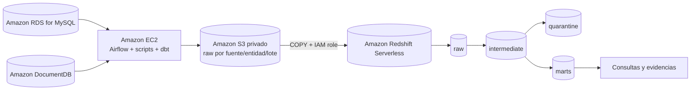

# Data Warehouse de comercio electrónico en AWS

## Integrantes

- Juan José Ramírez Pulgarín
- Juan Nicolás Cortés Rincón

## 1. Descripción general

Este proyecto implementa una solución de **Data Warehouse para un comercio
electrónico colombiano**, migrada desde una ejecución local hacia AWS. La
solución integra una fuente relacional, una fuente documental, almacenamiento
durable en Amazon S3, procesamiento analítico en Amazon Redshift y
orquestación con Apache Airflow y dbt ejecutados en una instancia Amazon EC2.

El diseño conserva las reglas de negocio del proyecto original y separa las
capas `raw`, `intermediate`, `quarantine` y `marts`. También contempla cargas
iniciales e incrementales, reprocesamiento de lotes, control de calidad,
idempotencia, trazabilidad de rechazos y dimensiones con historia SCD tipo 2.

> **Alcance:** por decisión del equipo y de acuerdo con la aclaración del
> taller, la sección de Amazon QuickSight se omite. El entregable termina en
> el Data Warehouse validado en Redshift y en la evidencia de su procesamiento.

## 2. Objetivos

El proyecto busca demostrar que es posible:

1. Migrar la fuente MySQL a Amazon RDS for MySQL.
2. Adaptar la fuente documental MongoDB para su uso con Amazon DocumentDB.
3. Extraer y conservar los datos en un bucket S3 privado.
4. Cargar los archivos de S3 en Redshift mediante `COPY` y un rol IAM.
5. Ejecutar Airflow y dbt en una instancia EC2.
6. Mantener el modelo dimensional y las reglas de negocio originales.
7. Registrar datos inválidos en cuarentena con su motivo y lote de origen.
8. Verificar calidad, incrementalidad, idempotencia, recuperación y SCD tipo 2.

## 3. Arquitectura



### Componentes

| Componente | Responsabilidad |
|---|---|
| Amazon RDS for MySQL | Fuente relacional: clientes, productos, órdenes y detalles |
| Amazon DocumentDB | Fuente documental: reseñas y eventos de navegación |
| Amazon S3 | Conservación de extracciones y reprocesamiento de lotes |
| Amazon Redshift Serverless | Data Warehouse analítico |
| Amazon EC2 | Ejecución de Airflow, scripts y dbt |
| Apache Airflow | Orquestación, dependencias, reintentos y logs |
| dbt | Transformaciones, snapshots y pruebas de calidad |
| IAM | Autorización de EC2 y Redshift hacia los recursos AWS |

### Recursos utilizados

| Recurso | Valor |
|---|---|
| Región | `us-east-2` |
| Bucket S3 | `de-dw-jjrp-1110` |
| Workgroup Redshift | `de-dw-jjrp-1110-redshift` |
| Base Redshift | `dev` |
| Rol EC2 | `de-dw-jjrp-1110-ec2-role` |
| Rol Redshift para S3 | `de-dw-jjrp-1110-redshift-s3-role` |
| Esquemas | `raw`, `intermediate`, `quarantine`, `marts` |

Los valores anteriores identifican la infraestructura usada en la
demostración. Las credenciales y secretos **no forman parte del repositorio**.

## 4. Estructura del repositorio

```text
.
├── docker/                 # Dockerfile, Compose y variables de ejemplo
├── docs/                   # Arquitectura, modelo, Airflow y etapas locales
├── evidence/               # Capturas de ejecución sin credenciales
├── scripts/                # Preparación, generación y verificación
├── src/
│   ├── airflow/dags/       # DAGs de Airflow
│   ├── dbt/                # Modelos, snapshots, macros, seeds y tests
│   └── ecommerce_dw/       # Extracción y generación de datos
├── warehouse/              # Artefactos locales; no contiene datos publicados
├── .env.example            # Variables locales de referencia
└── README.md
```

El proyecto conserva los DAGs y scripts locales del repositorio base para
permitir reproducibilidad y comparación. La ejecución AWS se documenta en
este README y en las evidencias del directorio `evidence/`.

## 5. Fuentes y entidades

### Fuente relacional

Amazon RDS for MySQL contiene:

- `customers`: clientes.
- `products`: catálogo de productos.
- `orders`: órdenes de compra.
- `order_items`: detalle de cada orden.

### Fuente documental

Amazon DocumentDB contiene:

- `reviews`: reseñas de productos.
- `navigation_events`: eventos de navegación.

La fuente documental conserva atributos propios de documentos, pero se
normaliza durante staging para alimentar los hechos analíticos.

### Diferencias MongoDB - DocumentDB

La adaptación conserva la estructura documental y evita depender de
operaciones específicas de MongoDB que no estén disponibles en DocumentDB.
La extracción debe usar consultas y operadores compatibles, convertir
identificadores a una representación estable y serializar los documentos
completos en JSON o Parquet antes de cargarlos a S3. Las transformaciones
analíticas no dependen de consultas complejas sobre documentos: reciben
columnas normalizadas y un campo `document_json` para auditoría.

## 6. Extracción y almacenamiento en S3

Cada lote se identifica con un `batch_id` y no sobrescribe los lotes
anteriores. La convención utilizada es:

```text
s3://de-dw-jjrp-1110/raw/<fuente>/<entidad>/batch_id=<batch_id>/data.parquet
```

Ejemplos:

```text
s3://de-dw-jjrp-1110/raw/rds/customers/batch_id=initial-001/data.parquet
s3://de-dw-jjrp-1110/raw/documentdb/reviews/batch_id=initial-001/data.parquet
```

El manifiesto del lote conserva:

- fuente;
- entidad;
- identificador del lote;
- fecha de extracción;
- URI del objeto S3;
- cantidad de registros.

Se eligió **Parquet** porque conserva tipos de datos, reduce el tamaño de
almacenamiento y es compatible con cargas analíticas en Redshift. Los archivos
se conservan para que un lote pueda reprocesarse sin volver a consultar las
fuentes.

### Conteos del lote inicial

| Fuente | Entidad | Registros |
|---|---|---:|
| RDS | customers | 54 |
| RDS | products | 27 |
| RDS | orders | 106 |
| RDS | order_items | 259 |
| DocumentDB | reviews | 158 |
| DocumentDB | navigation_events | 508 |

## 7. Data Warehouse en Redshift

Redshift reemplaza a DuckDB como almacén analítico de la solución AWS. La
carga sigue este orden:

1. Validar el manifiesto y la existencia del objeto en S3.
2. Cargar el lote mediante `COPY` usando el rol IAM de Redshift.
3. Registrar el lote y su estado en `raw.batch_control`.
4. Ejecutar los modelos dbt.
5. Materializar cuarentena, snapshots y marts.
6. Ejecutar las pruebas de calidad.

### Capas

| Capa | Propósito |
|---|---|
| `raw` | Datos recibidos desde S3, con metadatos de lote |
| `intermediate` | Tipificación, normalización y reglas de negocio |
| `quarantine` | Registros rechazados y motivo del rechazo |
| `marts` | Dimensiones y hechos para análisis |

### Control de lotes

La tabla `raw.batch_control` identifica un lote procesado mediante la
combinación de `batch_id`, fuente y entidad. Registra el URI de origen, fechas
de inicio y fin, cantidad de registros, estado y mensaje de error. El estado
se marca como `started` antes de la carga y como `success` únicamente después
de completar `COPY`, dbt y las pruebas. Si una tarea falla, se registra
`failed` y el mensaje queda disponible para la reejecución.

Esta estrategia evita considerar exitoso un lote parcialmente cargado y
permite reanudarlo sin perder el archivo original.

## 8. Modelo dimensional y SCD tipo 2

El modelo conserva las dimensiones de fecha, cliente, producto, canal y tipo
de evento, además de los hechos:

- `marts.fct_sales`
- `marts.fct_reviews`
- `marts.fct_navigation_events`

Los snapshots:

- `snap_dim_customer`
- `snap_dim_product`

conservan versiones históricas mediante:

- fecha de inicio de vigencia;
- fecha de fin de vigencia;
- indicador de registro actual;
- llave subrogada;
- comparación de atributos historizados.

Cuando cambia un atributo historizado, la versión anterior se cierra y se
inserta una nueva versión. Los hechos se relacionan con la versión válida para
su fecha de negocio.

## 9. Calidad y cuarentena

Las reglas incluyen:

- unicidad de identificadores;
- campos obligatorios;
- relaciones entre clientes, productos, órdenes y detalles;
- valores válidos de canales y tipos de evento;
- precios y cantidades no negativos;
- consistencia del subtotal;
- fechas obligatorias;
- conciliación del total de ventas.

Las filas rechazadas conservan el lote, la fuente, la entidad, el identificador
del registro, el motivo y el contenido necesario para su revisión. La
evidencia local disponible registra **32 rechazos** distribuidos entre las
entidades de MySQL y MongoDB.

## 10. Orquestación con Airflow

El DAG AWS debe ejecutar las tareas en este orden:

```text
validar parámetros y conexiones
        ↓
validar manifiesto S3
        ↓
cargar lote en raw mediante COPY
        ↓
ejecutar dbt seed
        ↓
ejecutar dbt snapshot
        ↓
ejecutar dbt run
        ↓
ejecutar dbt test
        ↓
registrar resultado del lote
```

Las dependencias son explícitas, los reintentos son acotados y cada tarea
incluye el `batch_id` en sus logs. Airflow y dbt se ejecutan en la misma
instancia EC2; las sentencias SQL de dbt se ejecutan en Redshift.

## 11. Resultados verificados

Las ejecuciones de dbt verificadas contra Redshift produjeron:

| Operación | Resultado |
|---|---|
| `dbt parse` | Correcto |
| `dbt seed` | 2 seeds cargados |
| `dbt snapshot` | 2 snapshots correctos |
| `dbt run` | 33 modelos correctos |
| `dbt test` | 92 pruebas correctas, 0 errores |

Conteos analíticos observados en el modelo inicial:

| Tabla | Filas |
|---|---:|
| `raw.mysql_customers` | 54 |
| `raw.mysql_products` | 27 |
| `raw.mysql_orders` | 106 |
| `raw.mysql_order_items` | 259 |
| `raw.mongo_reviews` | 158 |
| `raw.mongo_navigation_events` | 508 |
| `marts.dim_customer` | 50 |
| `marts.dim_product` | 25 |
| `marts.fct_sales` | 253 |
| `marts.fct_reviews` | 150 |
| `marts.fct_navigation_events` | 500 |

## 12. Escenarios de aceptación

| Escenario | Resultado esperado | Evidencia |
|---|---|---|
| Carga inicial | Datos disponibles en marts | `12-s3-manifest-and-parquet-counts.png`, `10-dbt-run-complete-ok.png` |
| Registros defectuosos | Rechazos identificados y trazables | `03-local-quarantine-counts.png` |
| Repetición de lote | Sin duplicación de hechos ni versiones | Consulta de conteos por `batch_id` |
| Nuevo lote incremental | Incorporación solo de registros nuevos | `scripts/verify_incremental_load.sh` |
| Cambio historizado | Nueva versión SCD2 y cierre de la anterior | `docs/etapas/08_cambios_scd2.md` |
| Fallo y reejecución | Recuperación sin pérdida ni duplicación | Estado `failed`/`success` en `raw.batch_control` |
| Conciliación | Total de origen igual al total de `marts.fct_sales` | `assert_sales_totals_match_source_by_business_date.sql` |

Los escenarios cuya captura no se encuentra en `evidence/` quedan descritos
con sus comandos y consultas reproducibles. No se deben presentar como una
captura ejecutada si no existe evidencia visual del resultado.

## 13. Reproducción local

La versión local permite validar las reglas de negocio antes de ejecutar la
migración AWS:

```bash
cp docker/.env.example .env
bash scripts/start_infrastructure.sh
bash scripts/create_source_schema.sh
bash scripts/generate_data.sh
bash scripts/run_pipeline.sh --existing-sources
```

Para ejecutar las pruebas dbt:

```bash
bash scripts/run_dbt.sh
```

Para probar un lote incremental:

```bash
bash scripts/verify_incremental_load.sh --batch-id 2
```

En AWS, los comandos equivalentes se ejecutan desde la instancia EC2 con las
variables de entorno del despliegue. Los secretos deben suministrarse por
variables de entorno, AWS Secrets Manager o un mecanismo equivalente; nunca
deben escribirse en el repositorio.

## 14. Evidencias

| Archivo | Qué demuestra |
|---|---|
| `01-docker-services.png` | Servicios locales activos |
| `02-redshift-model-counts.png` | Conteos de raw y marts |
| `03-local-quarantine-counts.png` | Registros rechazados |
| `04-redshift-schemas.png` | Esquemas del warehouse |
| `05-redshift-control-tables.png` | Tablas de control y cuarentena |
| `06-dbt-parse-ok.png` | Parseo correcto de dbt |
| `07-dbt-seed-ok.png` | Seeds cargados |
| `09-dbt-snapshots-initial-ok.png` | Snapshots SCD2 iniciales |
| `10-dbt-run-complete-ok.png` | 33 modelos correctos |
| `11-dbt-tests-ok.png` | 92 pruebas correctas |
| `12-s3-manifest-and-parquet-counts.png` | Manifiesto S3 y conteos Parquet |
| `13-redshift-debug-ok.png` | Conexión correcta con Redshift |

Las capturas deben revisarse antes de entregar para confirmar que no muestran
contraseñas, claves de acceso, tokens ni información que no deba publicarse.

## 15. Seguridad, costos y limitaciones

- No se versionan archivos `.env`, contraseñas ni claves AWS.
- Las credenciales compartidas durante la construcción deben rotarse antes de
  la entrega.
- El bucket S3 debe permanecer privado y usar políticas mínimas.
- El rol de Redshift solo debe tener acceso al prefijo S3 requerido.
- Redshift Serverless, RDS, DocumentDB y EC2 deben detenerse o eliminarse al
  terminar la demostración para evitar costos.
- Si DocumentDB no está disponible en la cuenta académica, se debe explicar
  que el lote documental conservado en S3 permite reprocesar la extracción,
  pero no sustituye conceptualmente una conexión activa a DocumentDB.
- QuickSight no hace parte de este entregable.

## 16. Documentación adicional

- [Arquitectura](docs/architecture.md)
- [Modelo de datos](docs/data_model.md)
- [Airflow](docs/airflow.md)
- [Conexiones](docs/connections.md)
- [Consultas analíticas](docs/analytical_queries.sql)
- [Etapas reproducibles](docs/etapas/)
